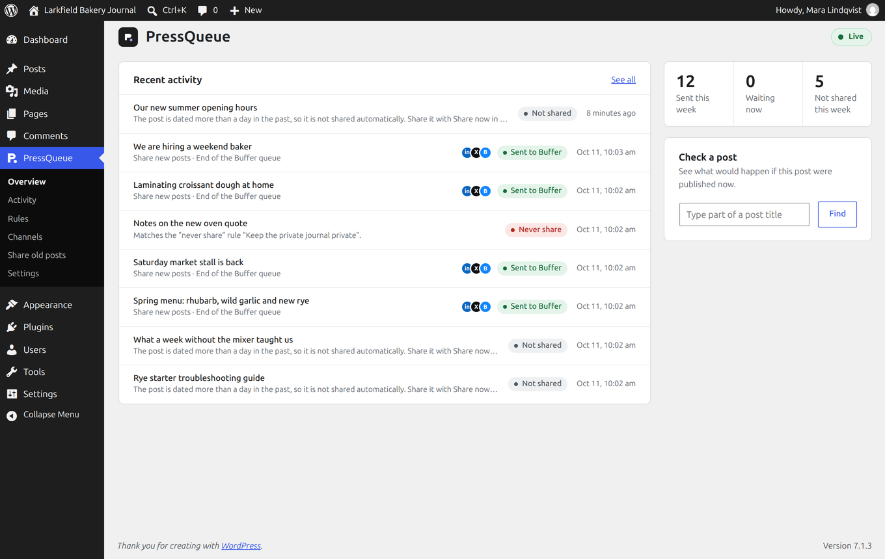
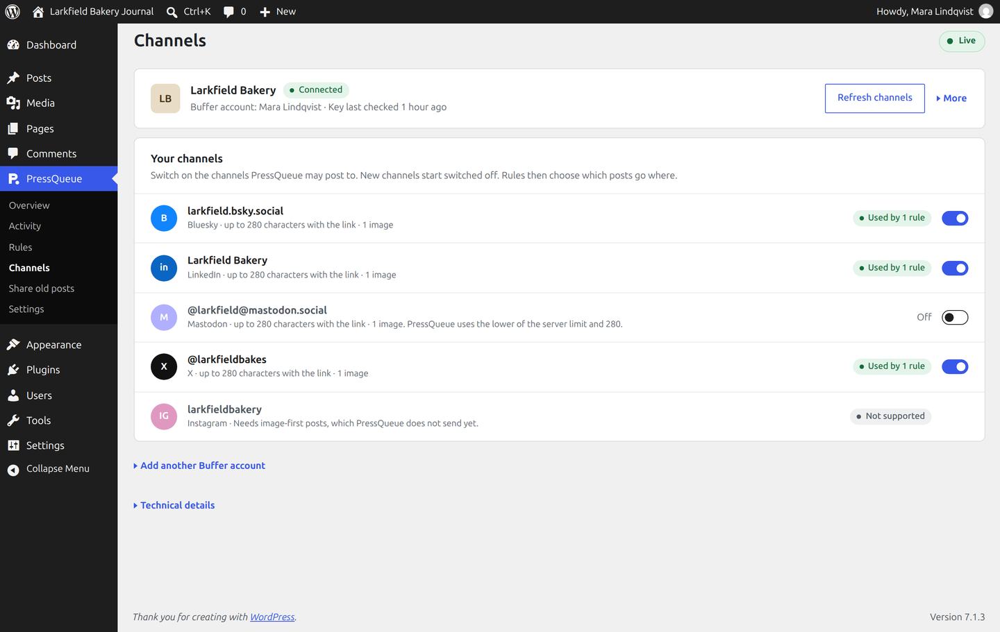
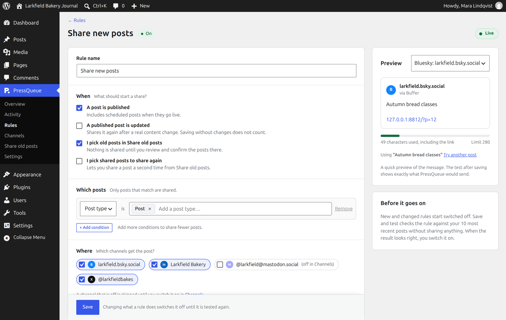
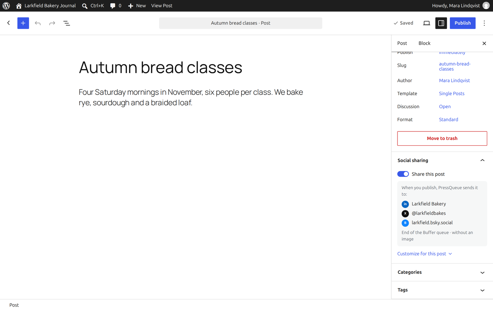
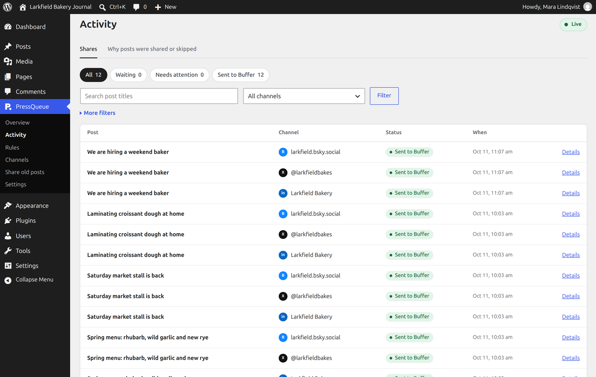

# PressQueue


PressQueue is a free WordPress plugin for Buffer. When you publish a post,
PressQueue adds it to your Buffer queue with the message and image your rules
set, and Buffer posts it on LinkedIn, X, Bluesky, Mastodon, Threads and
Facebook.

It is open source and has no Pro version, no license key and no account to
create. The plugin runs on your own server and talks to Buffer directly.

Website and documentation: [pressqueue.com](https://www.pressqueue.com)



## Features

- **Rules.** Pick posts by type, category, tag, author or custom field. Write
  the message with the title, excerpt and other parts of the post, with a
  different version for each network if you like. The live preview counts the
  characters, and the link is added for you.
- **Timing.** Add posts to the end of your Buffer queue or the next free slot,
  post them right away, save them as Buffer drafts, or pick a date and time
  for one post.
- **Social images.** PressQueue draws an image for each post from its title,
  in a style you pick once: 24 backgrounds, 6 fonts or your own background.
  The same image can be the link preview of the post, with The SEO
  Framework, Yoast SEO, Rank Math, Jetpack or no SEO plugin.
- **A switch in the editor.** Each post has a "Share this post" switch and a
  summary of where it goes. You can change the message, channels or timing for
  one post, or make sharing opt-in so new posts start switched off.
- **Share now and Share old posts.** Share a published post from the editor
  after a preview of what each channel gets, or pick up to 100 older posts and
  spread them across your Buffer queue.
- **"Never share" rules.** Keep a category, tag or author off social media.
  These rules win over every sharing rule.
- **Test mode, Live and Paused.** PressQueue starts in test mode and records
  what it would share without sending anything. Paused holds everything that
  is waiting until you resume.
- **Activity.** See what was sent, what is waiting and why a post was skipped.
  Every share has a stable identity, so saving a post again never posts it
  twice.

## Getting started

1. Download `pressqueue.zip` from the
   [latest release](https://github.com/vincentsch/pressqueue/releases/latest)
   and upload it under **Plugins > Add New > Upload Plugin**. Activate it.
2. Open **PressQueue** in the admin menu. The checklist on the Overview takes
   you through connecting Buffer, making a rule and going live.

The [getting started guide](https://www.pressqueue.com/docs/getting-started/)
explains each step. To run PressQueue from a Git checkout, run
`composer install --no-dev` in the plugin folder before you activate it.

## Screenshots

<details>
<summary>Connect Buffer and switch channels on</summary>



</details>

<details>
<summary>Build a rule with a live message preview</summary>



</details>

<details>
<summary>Decide per post in the editor</summary>



</details>

<details>
<summary>See what happened to every share</summary>



</details>

## Requirements

- WordPress 6.8 or newer and PHP 8.1 or newer, with PHP's Sodium extension,
  which PHP includes by default.
- MySQL 5.7.8 or MariaDB 10.2.3 or newer.
- A Buffer account. Buffer's free plan works.
- For social images, the PHP GD extension with FreeType, which most hosts
  have.

PressQueue shares text, a link and one image. Instagram, TikTok, YouTube,
Pinterest and video posts are not supported yet.

## Why an API key and not "Log in with Buffer"?

Buffer's login button needs every website's address registered with Buffer in
advance. That does not work for a plugin anyone can install on their own
site. You create a personal API key in Buffer's settings instead, and
PressQueue stores it encrypted with your site's security keys.

## Privacy

PressQueue keeps its rules and history in your WordPress database and sends
nothing to anyone but Buffer. When a rule uses images, it also checks the image
file on its host. Uninstalling keeps your data unless you switch on deletion
under **Settings > Data and privacy**. [Privacy and data](docs/privacy.md) has
the details.

## For developers

PressQueue has WP-CLI commands with JSON output, hooks for watching decisions
and deliveries, and a provider interface for adding services other than
Buffer:

- [WP-CLI commands](docs/developer/wp-cli.md)
- [Observation hooks](docs/developer/observation-hooks.md)
- [Provider adapters](docs/developer/provider-extensions.md)

### Running the checks

```bash
composer install
composer run test:unit
node --test tests/editor/*.test.cjs
composer run lint:phpcs
composer run analyse
```

Integration tests need the WordPress test suite and a throwaway database.
They create and drop tables, so never point them at a database you use:

```bash
bash tools/install-wp-tests.sh pressqueue_tests root '' 127.0.0.1 7.1.3
WP_TESTS_DIR=/tmp/wordpress-tests-lib-7.1.3 composer run test:integration
```

`composer run matrix:local` runs every supported PHP and WordPress version in
Docker. [Building and checking a package](docs/packaging.md) covers the full
release checks, and [CONTRIBUTING.md](CONTRIBUTING.md) explains how to
contribute.

## License

PressQueue's code is MIT licensed. The installable ZIP bundles Action
Scheduler, which is GPL-3.0-or-later, so the ZIP as a whole is distributed
under GPL-3.0-or-later. See [third-party notices](THIRD_PARTY_NOTICES.md).

## Help

Questions and bug reports go in the
[issues](https://github.com/vincentsch/pressqueue/issues). To report a
security issue, read [SECURITY.md](SECURITY.md).
